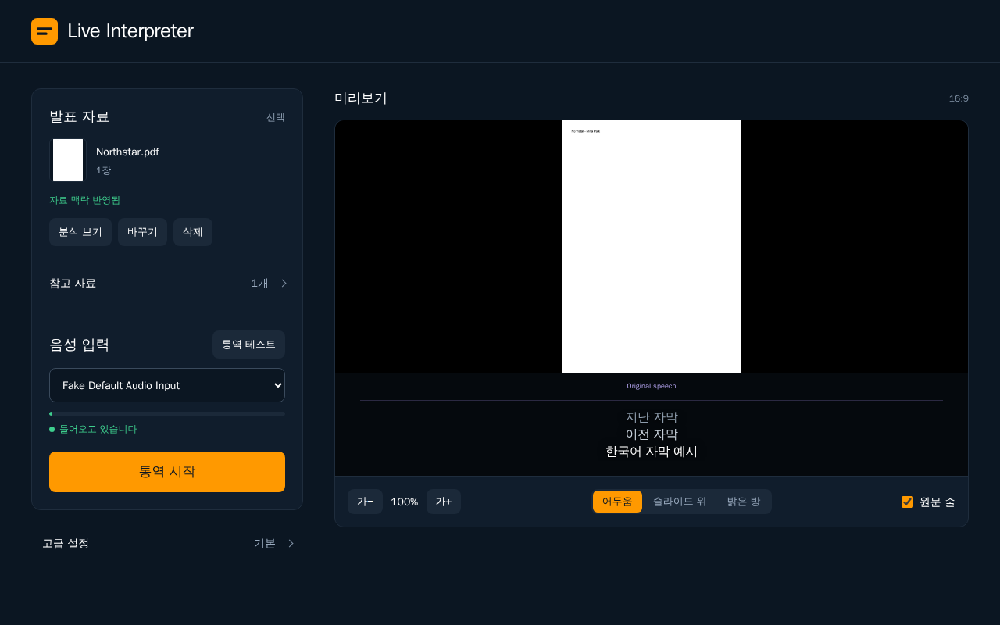
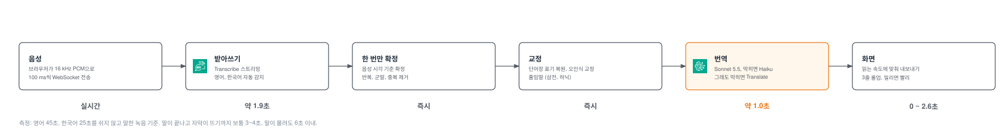
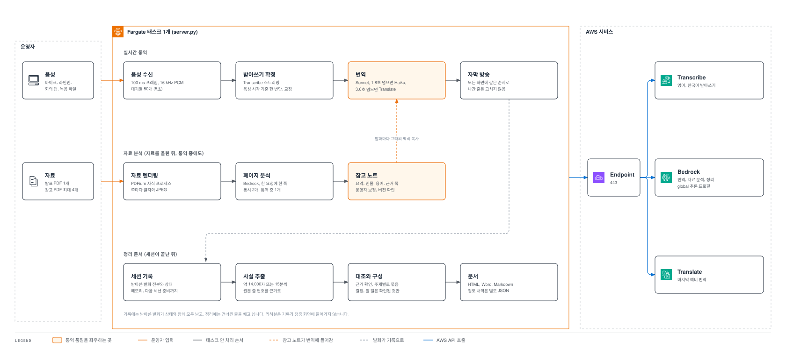
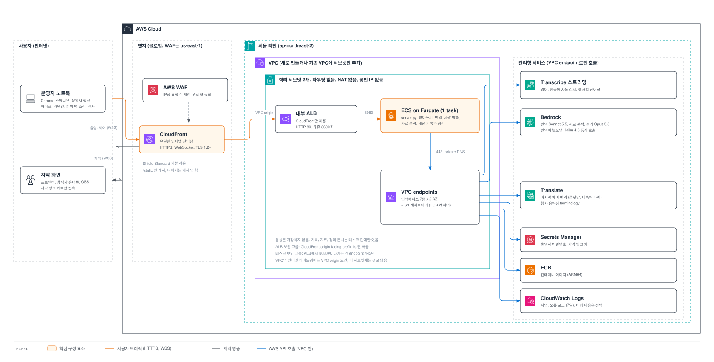

# Live Interpreter

**한국어** | [English](README.en.md)

영어와 한국어가 섞인 발표나 회의를 실시간 자막으로 통역합니다. 발표 자료를 미리 읽어 사람 이름과 용어를 맞추고, 끝나면 전체 기록과 요약 문서를 받을 수 있습니다.

실제 행사에서 베타 테스트를 거쳤고, 지금은 다른 행사에서도 쓸 수 있게 고쳤습니다.

> 개인 프로젝트입니다. AWS나 Anthropic의 공식 제품이 아니며, Amazon이나 Anthropic과 제휴하거나 보증받지 않았습니다.



## 주요 기능

- **양방향 실시간 자막**: 영어는 한국어로, 한국어는 영어로 자막을 띄웁니다. 말이 끝나고 자막이 뜨기까지 보통 3~4초입니다.
- **자료 기반 통역**: 발표 PDF 1개와 참고 PDF 최대 4개를 쪽마다 읽어 인물, 제품명, 용어를 통역에 반영합니다.
- **여러 화면에 같은 자막**: 발표 화면, 별도 자막 창, 참석자 휴대폰(QR), OBS에 같은 자막이 같은 순서로 나갑니다.
- **다양한 음성 입력**: 마이크, USB 오디오, 브라우저 탭 소리(온라인 회의), 녹음 파일을 쓸 수 있습니다.
- **비공개 통역 테스트**: 청중 화면과 기록에 남기지 않고 통역 결과를 미리 확인합니다.
- **기록과 정리 문서**: 전체 기록은 HTML, Word, CSV, Markdown으로, 발표 요약과 회의록은 HTML, Word, Markdown으로 받습니다.

## 사용 흐름

| 단계 | 운영자가 하는 일 | 뒤에서 일어나는 일 |
| --- | --- | --- |
| 준비 | 발표 PDF와 참고 PDF 올리기, 음성 입력 선택 | 자료를 쪽마다 읽어 요약, 인물, 용어를 모읍니다. 분석이 끝나기 전에 시작해도 됩니다 |
| 통역 테스트 | 실제 마이크로 몇 마디 말해 보기 | 운영자 화면에만 자막이 나옵니다. 청중 화면과 기록에는 남지 않습니다 |
| 통역 | **통역 시작**, 공유 메뉴에서 자막 창, 참석자 링크, QR 열기 | 모든 화면에 같은 자막이 같은 순서로 나갑니다 |
| 쉬는 시간, 질의응답 | 일시정지, 질의응답 버튼 | 일시정지는 기록과 맥락을 그대로 둡니다. 질의응답 중에는 현재 슬라이드 대신 전체 자료와 최근 발언을 참고해 통역합니다 |
| 종료 | 전체 기록 받기, **정리하기** | 원문 기록은 고치지 않은 그대로 받습니다. 정리 문서는 몇 분 걸립니다 |
| 다음 세션 | **새 세션 준비** | 자료, 발표자, 세션 용어, 기록을 지웁니다 |

운영자 링크는 세션을 제어할 수 있으므로 참석자에게 보내지 마세요.

## 동작 방식

말이 자막이 되기까지의 순서입니다. 걸리는 시간의 대부분은 받아쓰기가 문장을 확정할 때까지 기다리는 데 씁니다.



- **받아쓰기**: Amazon Transcribe 스트리밍이 영어와 한국어를 자동으로 구분합니다.
- **번역**: Amazon Bedrock의 Claude Sonnet이 번역합니다. 응답이 늦으면 Haiku, 그래도 늦으면 Amazon Translate가 대신합니다.
- **자막 고정**: 한 번 나간 자막은 고치지 않습니다. 그래서 화면이 깜빡이거나 같은 줄이 두 번 나오지 않습니다.

서버 안에서는 실시간 통역, 자료 분석, 정리 문서 작성이 따로 돌아갑니다.



정리 문서는 기록에서 사실을 원문 줄 번호와 함께 뽑고, 원문과 다시 대조한 뒤 주제별로 씁니다. 결정 사항과 할 일은 확인된 내용이 있을 때만 넣고, 없는 담당자나 기한은 만들지 않습니다. 원문 기록은 AI가 다시 쓰지 않습니다.

자세한 내용은 [아키텍처](docs/architecture.md)를 참고하세요.

## 빠르게 시작하기

내 컴퓨터에서 실행해 보는 방법입니다. 본인의 AWS 계정과 자격 증명이 필요합니다. 소스를 내려받는 것만으로는 AWS에 배포되거나 다른 사람의 환경에 연결되지 않습니다.

**준비물**: Python 3.12, [uv](https://docs.astral.sh/uv/), [Pandoc](https://pandoc.org/) 공식 배포본, AWS 자격 증명, Chrome

```bash
tools/bootstrap.sh                          # 의존성 설치
aws login                                   # AWS 로그인
.venv/bin/python setup_event.py --dry-run   # 만들 AWS 단어장 확인
.venv/bin/python setup_event.py             # 단어장과 용어집 생성
./start.sh --port 8083                      # 서버 실행
```

브라우저에서 `http://localhost:8083`을 열고 마이크 권한을 허용합니다. 단어장 없이 먼저 시험하려면 `./start.sh --port 8083 --no-vocabulary`를 사용합니다.

<details>
<summary>실행 옵션과 보안 참고</summary>

- 주요 옵션: `--event`, `--profile`, `--region`, `--model`, `--engine translate`, `--no-vocabulary`
- 기본 모델 ID는 `settings.py`에 있습니다. 사용하는 계정과 리전에서 해당 모델을 쓸 수 있어야 합니다.
- 서버는 기본적으로 내 컴퓨터(루프백 주소)에서만 열립니다. `--host 0.0.0.0`처럼 외부에서 접근하게 하려면 `OPERATOR_PASSWORD`가 필요합니다. 로그인 쿠키는 HTTPS에서만 동작하므로 앞단에 HTTPS 프록시를 두어야 합니다.
- 비밀번호와 운영자 링크를 공유 파일에 넣지 마세요.
- Linux 배포판의 Pandoc 패키지 중에는 Word 변환에 필요한 보안 모드를 지원하지 않는 것이 있습니다. 설치 스크립트가 이를 확인합니다.

</details>

## 행사 설정

`events/example.toml`을 새 이름으로 복사해 발표자, 예상 질문, 용어를 넣습니다. 예시는 가상의 행사입니다. `events/_base.toml`과 `glossary/`의 공통 용어는 모든 세션에 적용됩니다.

```bash
.venv/bin/python setup_event.py example --dry-run
./start.sh --event example --no-vocabulary --port 8083
```

## 자료와 기록

- PDF는 파일당 40MiB, 300쪽까지 올릴 수 있습니다. PowerPoint는 PDF로 저장해서 올려 주세요.
- 참고 자료는 통역할 때 참고만 하고, 참석자 화면에는 보이지 않습니다.
- 음성은 저장하지 않습니다. 자료와 기록은 서버의 메모리와 디스크에만 있고, 새 세션 준비나 서버 재시작으로 사라질 수 있습니다. 필요한 기록은 미리 내려받으세요.

데이터 처리와 제한은 [운영 안내](docs/operations.md)에 정리했습니다.

## AWS에 배포하기

AWS CDK로 배포하면 아래 구성을 만듭니다. 인터넷에서 들어오는 길은 CloudFront 하나이고, 서버는 인터넷 경로가 없는 서브넷에 있습니다.



배포 순서는 [배포 및 운영 안내](docs/operations.md)에 단계별로 정리했습니다. 직접 따라 해도 되고, 아래처럼 AI 코딩 도구에 맡길 수도 있습니다.

### AI 코딩 도구로 배포하기

저장소에는 각 도구가 읽는 지시 파일이 들어 있습니다. 어느 도구든 같은 [AGENTS.md](AGENTS.md) 규칙을 따릅니다. AWS 리소스를 만들거나 지우기 전에 매번 확인을 받고, 비밀번호나 운영자 링크를 화면에 출력하지 않습니다.

| 도구 | 읽는 파일 | 시작 방법 |
| --- | --- | --- |
| [Claude Code](https://claude.com/claude-code) | `CLAUDE.md` (→ `AGENTS.md`) | 저장소 폴더에서 `claude` 실행 |
| [Codex](https://developers.openai.com/codex) | `AGENTS.md` | 저장소 폴더에서 `codex` 실행 |
| [Kiro](https://kiro.dev) | `.kiro/steering/live-interpreter.md` (→ `AGENTS.md`) | Kiro에서 저장소 폴더 열기 |

1. 저장소를 내려받습니다.

   ```bash
   git clone https://github.com/leeay0219/live-interpreter.git
   cd live-interpreter
   ```

2. 터미널에서 직접 `aws login`으로 로그인합니다. 로그인은 AI 도구가 대신할 수 없습니다.
3. 도구를 열고 다음처럼 요청합니다.

   ```text
   docs/operations.md 순서대로 이 앱을 내 AWS 계정의 서울 리전에 배포해줘.
   AWS 리소스를 만들거나 바꾸는 명령은 실행하기 전에 매번 물어봐줘.
   ```

4. 배포가 끝나면 도구가 알려 주는 명령을 **AI 도구 밖의 내 터미널**에서 실행해 운영자 비밀번호나 링크를 확인합니다. 비밀번호를 AI 대화창에 붙여 넣지 마세요.
5. 행사가 끝나면 같은 도구에 "스택을 삭제해줘"라고 요청합니다. 삭제 후에도 남는 리소스는 도구가 함께 알려 줍니다.

배포하는 동안 비용이 계속 나갑니다. 아래 비용 표를 먼저 확인하세요.

### 비용

| 항목 | 추정 금액 | 비고 |
| --- | --- | --- |
| 배포해 두는 동안 | 하루 약 $7 | 절반 이상이 VPC endpoint. 쓰지 않아도 자동으로 멈추지 않습니다 |
| 45분 세션 번역 | 약 $1 | Transcribe 요금은 사용 시간에 따라 따로 나감 |
| 자료 분석, 정리 문서 | 자료 쪽수와 기록 길이에 비례 | 다시 분석하면 요금도 다시 나감 |

실제 비용은 리전, 모델, 사용량에 따라 다릅니다. 행사가 없는 기간에는 스택을 지우고 행사 전에 다시 배포하는 편이 저렴합니다.

## 알려진 제약

- 실시간으로 화자를 구분하지 않습니다. 자막에 누가 말했는지 표시되지 않습니다.
- Bedrock global 추론 프로필을 쓰면 요청이 선택한 리전 밖에서 처리될 수 있습니다. 데이터를 국내에서만 처리해야 한다면 모델과 추론 프로필을 따로 확인하세요.
- 모델은 원문을 잘못 해석할 수 있습니다. 정리 문서의 근거 줄 번호와 검토 내역으로 확인할 수는 있지만, 내용이 항상 맞다는 뜻은 아닙니다.

## 더 알아보기

| 문서 | 내용 |
| --- | --- |
| [docs/architecture.md](docs/architecture.md) | 데이터 흐름과 구조 |
| [docs/operations.md](docs/operations.md) | 배포, 운영, 데이터 처리 |
| [DESIGN.md](DESIGN.md) | 화면 디자인 규칙 |
| [CHANGELOG.md](CHANGELOG.md) | 버전별 변경 내역 |
| [CONTRIBUTING.md](CONTRIBUTING.md) | 개발, 테스트, 기여 방법 |

AI 코딩 도구(Codex 등)를 쓴다면 저장소의 [session-writeup 스킬](.agents/skills/session-writeup/SKILL.md)로 세션 기록을 회의록으로 정리할 수 있습니다. 앱의 **정리하기** 기능은 이 스킬 없이도 동작합니다.

## 라이선스

프로젝트 소스는 [Apache 2.0](LICENSE) 라이선스입니다. 외부 라이브러리는 각자의 라이선스를 따릅니다. [의존성 고지](THIRD_PARTY_NOTICES.md)를 참고하세요. 구성도에는 AWS Architecture Icons를 사용했습니다.
